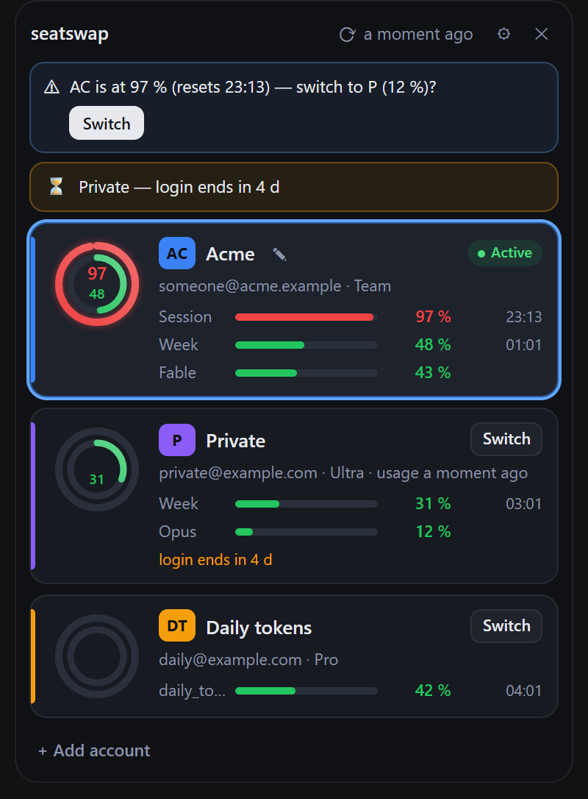
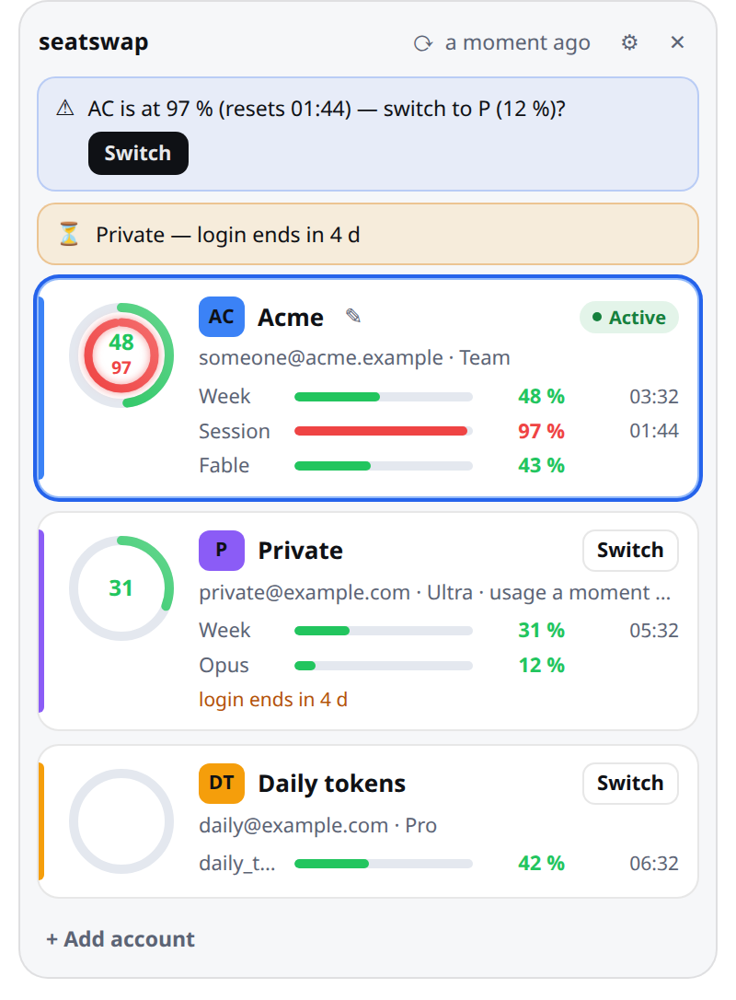

# seatswap

[](LICENSE)

A tray app and command line tool for Linux, Windows and macOS that switches
[Claude Code](https://docs.anthropic.com/en/docs/claude-code) between several Claude accounts with
one click. Only the login is swapped. Your `~/.claude` (on Windows `%USERPROFILE%\.claude`) stays
the same for every account: memory, skills, plugins, hooks, settings and history are shared.

The tray icon shows the active account's abbreviation (or, if you choose, its usage percent) with a
ring for how much of its limit is used. A click opens a pop-up with the session and weekly usage of
every stored account, so you can see at a glance which one still has room. Beyond that, seatswap
can switch by itself so that as little quota as possible expires (auto-burn), switches Codex between
saved OpenAI logins, shows the running Claude Code, Codex and DeepSeek Harness sessions, keeps a
history with statistics of what each subscription was used for and what it gives, and builds Claude
Code's status line.

<p>
  
  
</p>

<p>
  
</p>

<p>
  
</p>

<p>
  
</p>

<p>
  
</p>

<p>
  
</p>

*Screenshots show the app's built-in demo data and the made-up worlds of its test bench; every name in them is made up.*

> **Not affiliated with Anthropic.** seatswap works with Claude Code's own login files and
> the same endpoints Claude Code uses. They are undocumented and can change with any Claude Code
> release. Read [What it does with your login](#what-it-does-with-your-login) before you use it.

## Status

Built and used daily on **Linux Mint 22 Cinnamon (X11)**. On **Windows 11** version 1.2.2 was
checked by hand on 2026-11-18: the tray icon and pop-up, a switch that a running Claude Code session
follows, the notifications, start at login, settings shared with a Linux machine, the status line
and the Sessions area all work (Claude Code keeps its login in the same file there). The parts new in
1.3 and 1.4 pass their tests on Windows but have not run on a Windows desktop yet. **macOS** is
new: seatswap reads and writes Claude Code's login in the Keychain there, and the tests and a switch
by the command line ran on macOS 26 (Apple silicon), but it is not used daily yet and a switch that
a running Claude Code session follows has not been tried on a Mac.

## Features

- **One-click switch** from the tray menu or the pop-up, or `seatswap use AC`. Running Claude
  Code sessions pick up the new login on their next request.
- **A large window with Sessions, Statistics, Status line and Settings.** The gear in the pop-up (or
  `,`) opens a full window: Sessions, Statistics, Status line and Settings, each with its page.
  Settings holds every setting, plus the account editor that used to sit in the pop-up; the Status
  line area builds Claude Code's status line (below). `seatswap window [AREA]` opens it from a
  terminal, and so do the tray's *Sessions…*, *Statistics…* and *Settings…*, each at its area.
  Every control saves at once.
- **The Swap S icon.** A lowercase s with arrow ends on a green square
  (`crates/app/icons/icon.svg`) is the app icon of the launcher, the Windows `.exe`,
  notifications and every window; the tray icon stays the live account ring. On Linux the tray app
  also writes its menu entry and icon under `$XDG_DATA_HOME`, so it appears in the applications menu;
  a symbolic link there, and an entry it did not make, are left alone.
- **The Sessions area.** It shows every running Claude Code session on this host and, through the
  shared history folder, on your other hosts: live, with its agents to any depth, its tokens and
  what they are worth, and the sessions that closed in the last 24 hours, 7 or 30 days. Codex
  sessions and DeepSeek Harness sessions sit beside them, and a flash job hangs under the Claude
  Code session that started it, with its workers below; a job already named in a transcript is
  linked there, and on Windows a running job appears once its result is collected. A closed Codex
  session is not a row of its own yet, though its tokens are kept and counted in Statistics. A
  session goes by the name Claude Code shows for it, so a `/rename` shows within a minute; its
  agents are listed directly under it, each with its model. Numbers on top, two orders (by project →
  session, or by provider → model → session) and a card for what a switch would cost the running
  sessions. It updates by itself
  (at most twice a second) and needs *Read Claude Code's session files* (on by default); turning it
  on takes effect after a restart.
- **The Statistics area.** Seven pages over the recorded history, for a range from this week to
  all of it, with account chips and a host choice: Overview (what was used, expired, blocked and
  switched, this week's totals and projects split by subscription), Weeks (a grid of every account's
  week, with a summary per week and the detail of one window), Projects and organizations (where the
  subscriptions went, split by subscription), Subscriptions (what each plan
  gives, what is used of what is paid, what 1 % of a limit buys over the weeks, and the tokens a week
  per subscription and model), Forecast (the latest plan for the next 7 days), Rhythm (when your week
  is worked) and Activity (when each host worked, idled or was off). Claude accounts and OpenAI and
  Ollama subscriptions are shown together; blocked hours are shown per company. A sum keeps the part
  it knows and says `≥`; a share counts only priced work.
- **Money.** seatswap shows what tokens and subscriptions are worth: API prices from
  [models.dev](https://models.dev) and the dollar rate from the European Central Bank via
  [Frankfurter](https://frankfurter.dev), each kept with its dates and fetched time, so past days
  keep the price of that day. Set a currency and each account's or provider subscription's monthly
  price; the weekly percentage then has a money value. The model list under *Settings → Providers* is read-only. Claude Code's
  own reported cost beats a models.dev price; a model with neither has no API value rather than a
  guessed one, and a Claude Code model without a price is asked for from models.dev at once, at
  most once per model and hour. The rate is fetched once per Frankfurt day while it is older than today, and on working
  days from 16:00 again every 30 minutes until an answer carries today's date or it is 18:00. One
  switch, *Look up prices and the dollar rate*, turns both look-ups off; with it off, API values
  are in US dollars and the column says so. They send a User-Agent and nothing else — no account,
  token or machine data — and with the switch off neither site is contacted.
- **Projects and organizations.** seatswap groups the folders Claude Code works in into projects
  (a repository, or a folder), with names you choose, joins for the same project seen in two
  places, and organizations. Settings → Projects groups projects under their organization and can
  merge two organizations, split a merged one off again, and move a project to another organization;
  an organization that comes from a GitHub owner cannot be removed, and an empty one stays dimmed.
  Names that differ only in case are one organization. The project log travels with the history
  folder, so every host shows the same names once the folder has synced. History can be exported as
  CSV or JSON, and another history folder's files imported by hand.
- **Usage at a glance.** The icon ring shows the active account's binding limit, coloured green,
  amber or red. Inside the ring the icon shows the account's letters, or with *Settings → General →
  The tray icon shows* the ring's percent (100 % shown as 99, so it stays two digits). The pop-up shows every account's session (5 h) and weekly limits, with the time
  until each one resets — and its plan, such as "Team Premium".
- **OpenAI (Codex) and Ollama cards.** With a switch in *Settings → Providers*, the pop-up shows an
  OpenAI card and an Ollama card. The OpenAI card lists every saved Codex login, marks the live one
  and can switch Codex to another; an inactive login renews itself when its token expires. The
  Ollama card shows credits left, reset date, spend in the last 24 h, or session and weekly limits on
  an old plan. Both are off by default. A Codex login found in Codex's folder and an Ollama server
  found on `PATH` or named by this host's stored subscription are still read while a card is off,
  so their work is counted; a stopped Ollama says `Ollama is not running.` quietly. seatswap writes
  Codex's `auth.json` only when switching between saved logins; sign-in and sign-out
  stay Codex's own (`codex login`). Codex reads that file only when a session starts, so a switch
  reaches new Codex sessions; running ones keep their login until they restart. On Windows a Codex
  login is larger than one Credential Manager entry (2,560 bytes), so those copies are private files
  in seatswap's `secrets` folder; Codex switching works there too.
- **Auto-burn.** Switched on, seatswap moves between accounts by itself so that as little work as
  possible is blocked and as little quota as possible expires: it moves to an account that is at
  risk of losing quota at its weekly reset (8 working hours of slack or less), and switches before
  an account is full for any other reason only when the measured gain is worth the switch. Switched off, it suggests the same switch instead. It measures work in API dollars:
  each account learns how many percent of a limit one dollar of work at API prices uses, starting
  from a figure assumed from its plan.
- **Status line for Claude Code.** `seatswap statusline` prints the live account and its limits in
  Claude Code's status line, and hands the live numbers back to the tray app without an extra
  request. The large window's Status line area builds the line, previews it at three terminal
  widths, and turns it on in Claude Code with one button that can be undone.
- **History.** Every usage reading, finished window, switch and agent call is kept in an
  append-only history folder, one JSON Lines file per month and kind, with tokens per project,
  model and 5 minutes, and Ollama's hourly usage. Update every machine that shares a history
  folder to 1.3 together: older versions read the 5-minute token lines as hours. Several hosts can share it through a synced folder; each writes
  only its own subfolder.
- **A second computer.** Point both computers' history folder at the same synced folder, and the
  second one gets more than the shared history: each account's label, abbreviation, colour, price
  and whether auto-burn may use it, and your currency, notification and status line settings, follow
  you there. The last edit wins, and another computer's edit shows within a few minutes of the
  folder syncing. Logins never travel: log in to each account once on the new computer, and it then
  takes that account's look and price at once.
- **Running sessions in the pop-up.** seatswap reads Claude Code's session files and transcripts
  and shows how many sessions run, how many are busy, and how many are waiting for you. Only
  numbers and names leave the session files and transcripts: model, token counts, folder, session
  id; never message text.
- **Notifications that matter.** When a blocked account is usable again, when the last usable
  account fills up, or when a session has waited for you for 15 s. A click on a waiting notification
  opens the Sessions area at that session; with *For sessions on: all hosts*, another host's waiting
  sessions notify here too, with the delay of the shared folder.
- **Agent settings.** Two switches decide whether agents may read usage and may switch accounts;
  `seatswap agent-skill install` adds a skill that tells them how.
- **Logins kept fresh.** Stored logins of inactive accounts are refreshed before they expire, and
  the app warns a few days before an account needs a new `/login`.
- **Safe with running sessions.** It takes the same lock files Claude Code uses, so a switch never
  races a token refresh or a settings write.
- **Command line** for scripts and status bars (`--waybar`, `--i3blocks`, `--json`).

## Install

**Prebuilt (Linux x86_64):** download `seatswap-<version>-x86_64-linux.tar.gz` from the
[releases](https://github.com/ymihere/seatswap/releases), then:

```sh
tar xzf seatswap-*-x86_64-linux.tar.gz
install -m 0755 seatswap-*/seatswap ~/.local/bin/
```

It needs WebKitGTK 4.1 at run time (Debian, Ubuntu, Mint:
`sudo apt install libwebkit2gtk-4.1-0`). Built on Ubuntu 24.04 (glibc 2.39, the same as Linux
Mint 22); on an older system, build from source.

**Prebuilt (Windows x86_64):** download `seatswap-<version>-x86_64-windows.zip` from the
[releases](https://github.com/ymihere/seatswap/releases) and unpack `seatswap.exe` and
`seatswap-tray.exe` into one folder, best one that is on your `PATH`. Start `seatswap-tray.exe`
for the tray app; `seatswap.exe` is the command line. Keep the two side by side: "start at
login" starts the `seatswap-tray.exe` next to the program you ran. The programs are not signed,
so Windows may ask before the first start. They need the WebView2 runtime, which Windows 11
has; on Windows 10 install it from Microsoft if the pop-up does not open.

**Prebuilt (macOS, Apple silicon):** download `seatswap-<version>-aarch64-macos.tar.gz` from the
[releases](https://github.com/ymihere/seatswap/releases), then:

```sh
tar xzf seatswap-*-aarch64-macos.tar.gz
install -m 0755 seatswap-*/seatswap ~/.local/bin/
xattr -d com.apple.quarantine ~/.local/bin/seatswap   # only if a browser downloaded it
```

The program is not signed or notarized, so macOS refuses to open a copy a browser downloaded until
the quarantine mark is removed (the last line). On an Intel Mac, build from source.

**From source:** you need Rust ≥ 1.91
([rustup](https://rustup.rs)) and, on Linux, the libraries Tauri needs. On Debian, Ubuntu and
Mint:

```sh
sudo apt install build-essential pkg-config libwebkit2gtk-4.1-dev libxdo-dev \
  libayatana-appindicator3-dev librsvg2-dev
```

Then:

```sh
git clone https://github.com/ymihere/seatswap
cd seatswap
cargo build --release -p seatswap
install -m 0755 target/release/seatswap ~/.local/bin/
```

On Windows the same `cargo build` (with Rust's default MSVC toolchain) leaves `seatswap.exe` and
`seatswap-tray.exe` in `target\release`; copy both into one folder. macOS needs nothing besides
Rust and the Xcode command line tools (`xcode-select --install`).

Only the command line, without the tray: `cargo build --release -p seatswap --no-default-features`.

### Starting it

- **Linux:** start it with `seatswap`. The tray needs a StatusNotifierItem host: Cinnamon, KDE
  Plasma, Xfce and MATE have one; GNOME needs the *AppIndicator and KStatusNotifierItem Support*
  extension. Without one, seatswap runs without an icon and says so; `seatswap panel` opens the
  pop-up, and the icon appears once a tray does.
- **Windows:** start `seatswap-tray.exe`. Windows puts a new tray icon into the overflow area
  behind the `^` arrow next to the clock; drag it onto the taskbar to keep it in view.
- **macOS:** start it with `seatswap`. The icon appears in the menu bar; seatswap has no Dock icon.

On every system, seatswap adds itself to the programs started at login (switch it off under
*Settings → Start at login*).

## Getting started

1. Log in to your first account in Claude Code as usual (`/login`).
2. Save it: *Add account…* in the tray menu, or `seatswap add`.
3. Log in to the next account in Claude Code (`/login`) and save it the same way.
4. Switch with a left click on the icon (pop-up) or from the menu, or `seatswap use <abbr>`.

Each account gets a one- or two-letter abbreviation and a colour, both editable in the large
window (*Settings → Accounts*, the ✎ or the badge) or with `seatswap edit <account> --abbr XY --color '#3b82f6'`.
Clicking an account's badge or ✎ in the pop-up opens that editor.

## Usage

| Action | Effect |
|---|---|
| Left click on the icon | Open or close the pop-up |
| Right click | Menu: one entry per account (click to switch), *Open panel…*, *Add account…*, *Sessions…*, *Statistics…*, *Settings…* (each the large window at its area), *Quit seatswap* |
| Hover | Tooltip with the active account's session and weekly usage |
| In the pop-up | ↑/↓ move, Enter switches, 1–9 switch directly, `,` settings in the large window, Esc closes |
| Account badge or ✎ | That account's editor in the large window (*Settings → Accounts*) |

There is no built-in global shortcut yet. On Linux, bind `seatswap panel` to a key in your
desktop's keyboard settings (Ctrl+Alt+C, for example). On Windows the command for such a shortcut
is `seatswap-tray.exe panel`, which opens no console window.

## Status line and auto-burn

**Build the status line in the large window.** The Status line area (the third tab, or
`seatswap window statusline`) has a palette of segments in three groups — seatswap, Claude Code
and System — and two zones, Left and Right, that you fill by dragging or with the keyboard. Each
segment has its own options: a colour rule, prefix and suffix, a drop order for narrow terminals,
a time format for the two reset segments and a text for the free text segment. A separator's
character is chosen from pipe `│`, middle dot `·`, bullet `•`, slash `/`, chevron `›` or blank;
spaces in a prefix or suffix are shown as a faint dot with a count. `│ · • ›` are East Asian
"ambiguous" width: a terminal that draws them two columns wide makes the line one column wider per
separator. Dropping a segment on the Segments box removes it, and so does the Options card's
*Remove*; Delete keeps working. A preview
shows the line at three widths you can change, on a dark or a light terminal, with the live numbers
or a test case, and says what was dropped. Three presets are a click away; *My current line*
reproduces the old script.

**Use in Claude Code.** The button shows the change first — the file, the `statusLine` value now
and after — and then writes it. seatswap writes exactly one key, `statusLine`, of Claude Code's
`settings.json` (`~/.claude/settings.json`; on Windows `%USERPROFILE%\.claude\settings.json`), keeps
every other key as it was and in the same order, and backs the file up once as
`settings.json.seatswap-backup`. The value is

```json
{"type": "command", "command": "\"<path>\" statusline", "refreshInterval": 2}
```

with the console `seatswap` program beside the running one, always in double quotes so bash (or Git
Bash on Windows) reads a path with spaces as one word. *Restore previous* puts the value that was
there exactly back, or removes the key if there was none, and is offered only while seatswap's line
is the one in the file. To undo it without the window, delete that `statusLine` key in
`settings.json` (or put the old value back); nothing else in the file was touched.

**Without the window**, add this top-level key to Claude Code's `settings.json` yourself:

```json
"statusLine": {"type": "command", "command": "\"<path>\" statusline", "refreshInterval": 2}
```

Claude Code then runs `seatswap statusline` every 2 seconds. The command reads Claude Code's JSON
from standard input and prints one line with the account, its 5 h and weekly numbers and the reset
times. It never uses the network, never waits on a lock and always exits 0; any error is the line
`seatswap: <reason>`. The layout comes from seatswap's settings, and the same settings are what the
builder edits.

**What auto-burn does.** One switch in the settings, `Auto-burn`, off by default.

- On, seatswap switches accounts by itself; off, with `Suggest switches` on, the pop-up and a
  notification say what it would do, with a Switch button.
- It never leaves the active account blocked while another one is usable; when the active account
  is blocked and every account is full, it says when the next one resets.
- It leaves an account at 95 % of its 5 h window when another account's window has room: the
  window holds no quota of its own, and the usage figure trails the real use by a few minutes. With
  no such account it stays and uses the window up to 100 %.
- It switches before an account is full to an account at risk of losing quota at its weekly reset:
  one that needs nearly all the working hours left before that reset to use its quota up, alone or
  together with the accounts that reset before it (8 typical working hours or less to spare, since
  the machines may be off). It goes back to such an account
  as soon as its 5 h window resets. Other early switches come only after it has measured the
  accounts' rates and what a switch costs, and only when one is expected to save at least 0.5
  working hours and twice its extra switches' cost.
- A switch that would make busy sessions lose their earlier thinking waits for a quiet moment. A
  switch by hand holds nothing back; to keep your choice, Pause 4h suspends early switching. An
  early switch comes at least 5 minutes after the last switch.
- Every account has "Auto-burn may use this account"; off, it is never a target. Each switch is
  written to the history with its reason.

The plan is visible before it runs: `seatswap burn plan` prints the regime and the plan auto-burn
follows (the eager one while early switching is on, otherwise the lazy one) as time ranges, and
`seatswap burn plan --json` prints the same as one object.

**The status in JSON.** `seatswap status --json` prints one object for scripts: `views` (every
account, each with `usable` and, while it is known, `slackHours`), `active` (the id in use, or
null), `suggestion` (`{toId, text}` or null), `autoBurn` (`{on, pausedUntil}`), `next` (the id
auto-burn would switch to, or null) and `burnError` (a history or planner error, or null). Like
`seatswap burn plan`, `next` is planned without the sessions' thinking data, so while a session on
a model that would lose its thinking runs it can name another account than the pop-up.

To see what the two policies would have done with recorded work:

```sh
seatswap burn simulate --from 2026-11-09 --to 2026-11-15
seatswap burn simulate --from 2026-11-09 --to 2026-11-15 --without LB
```

It prints, for **lazy** and **eager**, the hours worked and blocked, the number of switches and the
percent that expired at each account's reset. Both commands only read.

## Command line

```
seatswap                        start the tray app
seatswap list                   stored accounts and their cached usage
seatswap use <account>          switch to an account (id or abbreviation)
seatswap next                   switch to the next usable account
seatswap add [--label TEXT]     save the live login as an account
seatswap edit <account> [--label TEXT] [--abbr XY] [--color '#rrggbb']
seatswap rm <account>           remove an account and its stored login
seatswap status [--json | --waybar | --i3blocks] [--refresh]
seatswap statusline             Claude Code's status line (reads its JSON from stdin)
seatswap burn plan [--json]     the early-switching regime and the plan auto-burn follows
seatswap burn simulate --from YYYY-MM-DD --to YYYY-MM-DD [--without ABBR]
                                replay the recorded work for the lazy and eager policies
seatswap codex list [--json]    the saved Codex logins, live first
seatswap codex switch <ABBR>    switch Codex to a saved login
seatswap panel [main|add|settings]   open the running app's pop-up; settings opens the large window
seatswap window [AREA]          open or focus the large window (sessions|statistics|statusline|settings)
seatswap prices [--refresh]     the stored API prices, USD per million tokens; --refresh asks models.dev
seatswap history export --format csv|json [--from YYYY-MM-DD] [--to YYYY-MM-DD]
                                write the history to standard output (UTC days, --to inclusive)
seatswap history import <folder>   copy another history folder's host folders in
seatswap agent-skill install|uninstall [--force]   add or remove the skill for agents
```

Every command takes `--claude-config-dir DIR` (default: the setting, then `$CLAUDE_CONFIG_DIR`,
then `~/.claude`) and `--data-dir DIR` (default: `~/.config/seatswap` on Linux,
`%APPDATA%\seatswap` on Windows).

On Windows, `seatswap-tray.exe` is the same program without a console window: use it to start
the tray app, and `seatswap.exe` for everything you want to read in a terminal.

## What it does with your login

- **What changes on a switch:** only the login entries in `~/.claude/.credentials.json` and the
  `oauthAccount` entry in `~/.claude.json` (on Windows both are under `%USERPROFILE%`). Every
  other key in those files is kept exactly as it was, in the same order.
- **On macOS** Claude Code keeps the login in the login Keychain, not in `.credentials.json`: the
  item `Claude Code-credentials` (with a config folder other than `~/.claude`,
  `Claude Code-credentials-` and the first 8 hex digits of the folder path's SHA-256), account
  `$USER`. seatswap reads and updates that item in place with `/usr/bin/security`, the program
  Claude Code uses itself, so macOS asks nothing and Claude Code keeps its access. The value goes
  to `security` on its standard input; only a login too long for one `security -i` line (about
  4 KB) is passed on the command line, as Claude Code does. A Claude Code that falls back to
  `.credentials.json` on a Mac: start seatswap with `SEATSWAP_CLAUDE_LOGIN=file`
  (`keychain` is the default there; on Linux and Windows only `file` is allowed).
- **One backup:** before seatswap writes to one of these two files for the first time, it keeps a
  copy next to it, named `<file>.seatswap-backup`. The copy contains the login of that moment and
  is never updated. On macOS the copy of the Keychain login is the item
  `<service>.seatswap-backup` beside it.
- **Where stored logins live:** the saved Claude logins and the saved Codex logins are in your
  system keyring (Secret Service on Linux, Credential Manager on Windows, the login Keychain on
  macOS, where a new build may ask once to *Always Allow* its own entries). If no keyring is available, in files in the data folder, and the pop-up
  says so. On Linux those files have mode `0600`; on Windows they are protected only by the
  permissions of your user folder. On Windows, Codex logins are always private files in the
  `secrets` folder, because one does not fit a single Credential Manager entry.
- **What else it writes:** its own data folder (including `feed.json`, the status line's live
  numbers, `burn-next.json` and `notification-icon.png`, the picture its notifications show), the
  one key `statusLine` of Claude Code's `settings.json` when you press *Use in Claude
  Code*, Codex's `auth.json` when you switch Codex to another saved login, its Linux menu entry and
  icon under `$XDG_DATA_HOME`, and the entry that starts it at login
  (`~/.config/autostart/seatswap.desktop` on Linux, the value `seatswap` under
  `HKCU\Software\Microsoft\Windows\CurrentVersion\Run` on Windows). On Windows it also registers
  the name its notifications are shown under
  (`HKCU\Software\Classes\AppUserModelId\dev.seatswap.app`).
- **Codex and Ollama:** while the Codex card is on or when seatswap finds a Codex login file,
  seatswap reads Codex's `auth.json` for the access token and account id it sends to `chatgpt.com`,
  and keeps a copy of every ChatGPT login it sees there, so it can switch back to it. It writes
  `auth.json` only for a switch, holding Codex's own two locks (`auth.lock`, `auth.json.lock`), and
  every key stays as Codex wrote it. It never renews the live login; that stays Codex's job. A saved
  login that is not live is renewed once at OpenAI's own token endpoint when its token has run out.
  A login Codex keeps in the OS keyring, or an API key, is not saved or switched. With the Ollama
  card on, when the `ollama` program is on `PATH`, or when this host has an Ollama subscription,
  seatswap asks the Ollama server for the balance and the last 24 h's spend. Both
  cards are off by default, and neither sends a request that generates text.
- **Sessions and the files behind them:** with *Read Claude Code's session files* on, seatswap also
  reads Codex's rollout files (`<codex folder>/sessions/YYYY/MM/DD/rollout-*.jsonl`) and thread
  names (`<codex folder>/session_index.jsonl`; the folder is the *Codex folder* setting,
  `$CODEX_HOME` or `~/.codex`), DeepSeek Harness's sessions
  (`$DSH_HOME/sessions` or `~/.dsh/sessions`) and flash-agents' job reports (`$FLASH_DATA_DIR`;
  else on Windows `%LOCALAPPDATA%\flash-agents`, elsewhere `$XDG_STATE_HOME/flash-agents` or
  `~/.local/state/flash-agents`). While the saved settings name
  no history folder, it reads Dropbox's `info.json` (macOS and Linux `~/.dropbox/info.json`; Windows
  `%APPDATA%\Dropbox\info.json`, then `%LOCALAPPDATA%\Dropbox\info.json`) only to suggest
  `<Dropbox>/seatswap` as the history folder; a file it cannot read is shown with its path and why.
  All of these are read only and never written. seatswap keeps ids, folders, model names, token counts,
  times, a Claude Code session's title (the one VS Code and `/resume` show) and a DeepSeek Harness
  session's or Codex thread's own title; message text is never stored, and neither are a flash job's or worker's
  title or task text (shown in the window and cleared before the report other hosts read).
- **Network:** the usage endpoint (`api.anthropic.com/api/oauth/usage`) and Claude Code's token
  endpoint (`platform.claude.com/v1/oauth/token`, with Claude Code's own client id) to refresh
  stored logins. While the Codex card is on or a Codex login file is found,
  `chatgpt.com/backend-api/wham/usage` with each login's own access token and account id, and
  `auth.openai.com/oauth/token` to renew a saved login that is not live; while the Ollama card is on,
  the `ollama` program is found, or this host stores an Ollama subscription, the server at
  `ollamaUrl` (default `http://127.0.0.1:11434`) for `/api/balance` and `/api/usage?range=24h`, with
  no secret. And, only while *Look up prices and the dollar rate* is on, `models.dev` for API prices and
  `api.frankfurter.dev` for the dollar rate; those two send a User-Agent and nothing about you, your
  accounts or this machine. Nothing else.
- **Logs and output** never contain a token; at most the last four characters of a refresh token.
- **What it records:** the history (every usage reading, finished window, switch and agent call,
  the tokens each session used per project folder, 5 minutes and model, Ollama's hourly usage, and each
  edit of an account's label, abbreviation, colour or price and of a shared setting) and,
  for your other hosts, a live report of this host's running sessions (`sessions-now.json`: session
  names and titles, folders, models and token counts, never an agent's task text or a worker's title). Both go
  into the history folder: by default `history` in the data folder; the setting `historyDir` can
  point it at a synced folder so several hosts share it, and then these records travel with that
  service. From the session files and transcripts seatswap keeps only numbers and names; it never
  stores message text. *Read Claude Code's session files* off stops reading sessions, transcripts
  and the Codex and Harness files.
- **Locks:** a switch holds Claude Code's own lock files (the renewal locks of the main and the two
  secondary logins, credentials write, identity write) and its own app lock, so it never
  overwrites a login Claude Code is writing. A Codex switch likewise holds the app lock and Codex's
  two lock files.

Whether using a subscription login this way is within Anthropic's terms is for you to judge; see
[Anthropic's terms](https://www.anthropic.com/legal/consumer-terms).

## Platform support

| Platform | Status |
|---|---|
| Linux Mint 22 Cinnamon (X11) | **Used daily**: icon, tooltip, left-click pop-up, menu |
| KDE Plasma, Xfce, MATE | Expected to work (StatusNotifierItem) |
| GNOME | Needs the AppIndicator extension |
| Wayland sessions | Expected to work; the pop-up is centred, the compositor places it |
| Windows 11 | **Checked by hand with 1.2.2** on 2026-11-18: tray icon, pop-up, a switch a running session follows, notifications, start at login, shared settings, status line, Sessions. The parts new in 1.3 and 1.4 pass their tests there but have not run on a desktop yet; Codex logins are now private files in seatswap's `secrets` folder. `seatswap.exe` is the CLI, `seatswap-tray.exe` the same program without a console window (autostart, Start menu). Works while Claude Code keeps its login in `.credentials.json`; a newer Claude Code can move it into Windows Credential Manager, which is not supported yet |
| Windows 10 (1803 or later) | Expected to work; not run yet |
| macOS 26 (Apple silicon) | **New**: Claude Code's login in the Keychain, running sessions (through `ps`), notifications, the menu-bar icon without a Dock icon, start at login (a LaunchAgent). The tests pass and a switch by the command line ran end to end on 2026-11-21; a switch that a running Claude Code session follows and the tray app in daily use are not checked yet. Release build for Apple silicon only; not signed or notarized |

## Development

```sh
cargo test --workspace
cargo clippy --workspace --all-targets -- -D warnings
cargo clippy -p seatswap --no-default-features --all-targets -- -D warnings   # CLI only
cargo fmt --check
```

Design: [docs/spec.md](docs/spec.md) (what and why) and
[docs/implementation.md](docs/implementation.md) (module contracts). How to contribute:
[CONTRIBUTING.md](CONTRIBUTING.md).

## Licence

MIT — see [LICENSE](LICENSE). The bundled font `DejaVuSans-Bold.ttf` has its own free licence
([crates/app/assets/DejaVuSans-LICENSE.txt](crates/app/assets/DejaVuSans-LICENSE.txt)).
