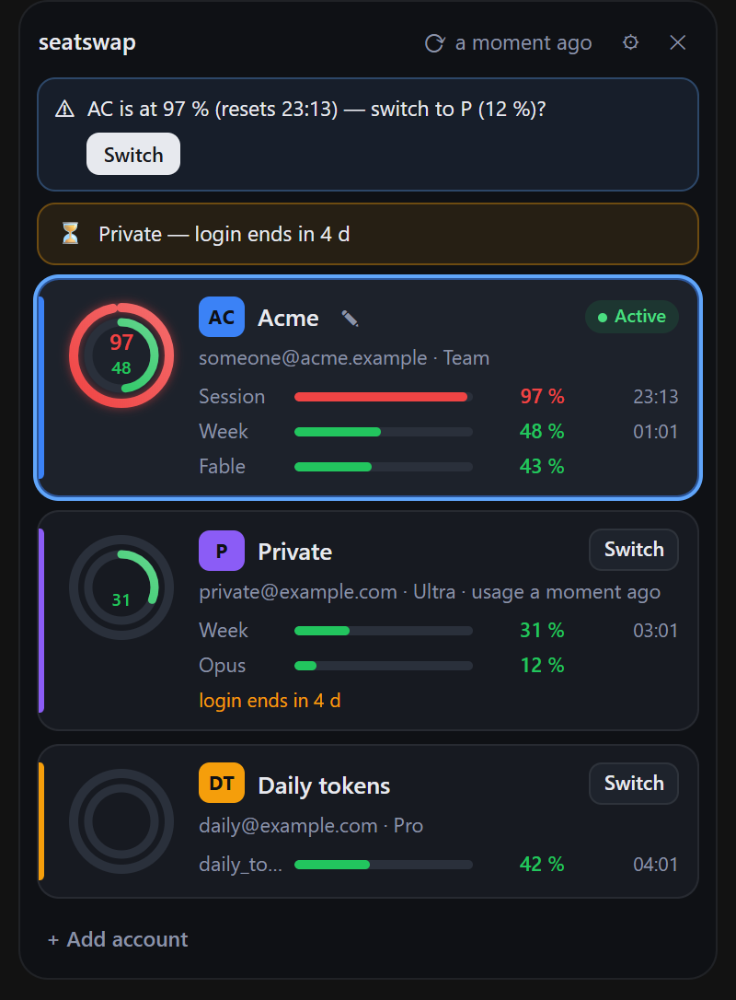
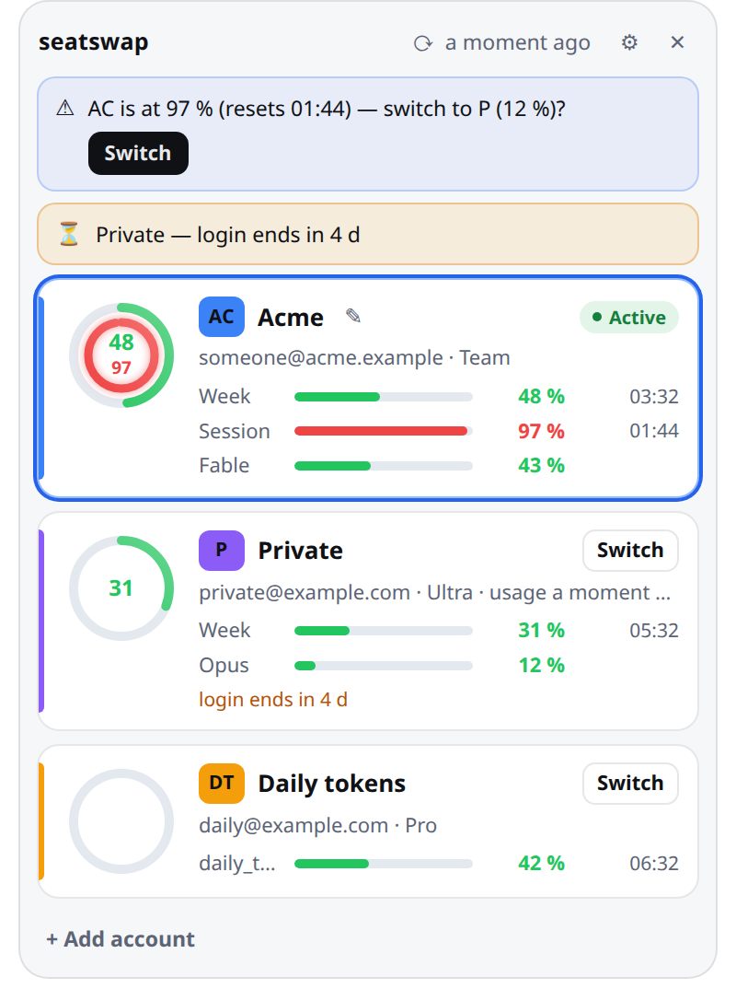

# seatswap

[](https://github.com/ymihere/seatswap/actions/workflows/ci.yml)
[](LICENSE)

A tray app and command line tool that switches [Claude Code](https://docs.anthropic.com/en/docs/claude-code)
between several Claude accounts with one click. Only the login is swapped. Your `~/.claude` stays
the same for every account: memory, skills, plugins, hooks, settings and history are shared.

The tray icon shows the active account's abbreviation with a ring for how much of its limit is
used. A click opens a pop-up with the session and weekly usage of every stored account, so you can
see at a glance which one still has room.

<p>
  
  
</p>

*Screenshots show the pop-up's built-in demo data.*

> **Not affiliated with Anthropic.** seatswap works with Claude Code's own login files and
> the same endpoints Claude Code uses. They are undocumented and can change with any Claude Code
> release. Read [What it does with your login](#what-it-does-with-your-login) before you use it.

## Status

Early (0.1). Built and used daily on **Linux Mint 22 Cinnamon (X11)**. On Windows 11 it builds
and passes its tests (Claude Code keeps its login in the same file there), and the tray app had
its first run there on 2026-11-11; not every check of that run is done yet. macOS is
not supported yet: Claude Code keeps its login in the Keychain there, and seatswap does not
read or write that yet.

## Features

- **One-click switch** from the tray menu or the pop-up, or `seatswap use AC`. Running Claude
  Code sessions pick up the new login on their next request.
- **Usage at a glance.** The icon ring shows the active account's binding limit, coloured green,
  amber or red. The pop-up shows every account's session (5 h) and weekly limits, with the time
  until each one resets.
- **Switch suggestion.** When the active account passes 90 % and another one is under 50 %, the
  pop-up (and a desktop notification) offers the switch.
- **Logins kept fresh.** Stored logins of inactive accounts are refreshed before they expire, and
  the app warns a few days before an account needs a new `/login`.
- **Safe with running sessions.** It takes the same lock files Claude Code uses, so a switch never
  races a token refresh or a settings write.
- **Command line** for scripts and status bars (`--waybar`, `--i3blocks`, `--json`).

## Install

**Prebuilt (Linux x86_64):** download `seatswap-<version>-x86_64-linux.tar.gz` from the
[releases](https://github.com/ymihere/seatswap/releases), then:

```sh
tar xzf seatswap-*-x86_64-linux.tar.gz
install -m 0755 seatswap-*/seatswap ~/.local/bin/
```

It needs WebKitGTK 4.1 at run time (Debian, Ubuntu, Mint:
`sudo apt install libwebkit2gtk-4.1-0`). Built on Linux Mint 22 (glibc 2.39); on an
older system, build from source.

**From source:** you need Rust ≥ 1.91
([rustup](https://rustup.rs)) and, on Linux, the libraries Tauri needs. On Debian, Ubuntu and
Mint:

```sh
sudo apt install build-essential pkg-config libwebkit2gtk-4.1-dev libxdo-dev \
  libayatana-appindicator3-dev librsvg2-dev
```

Then:

```sh
git clone https://github.com/ymihere/seatswap
cd seatswap
cargo build --release -p seatswap
install -m 0755 target/release/seatswap ~/.local/bin/
```

Start it with `seatswap`. It adds itself to your desktop's autostart (switch it off under
*Settings → Start at login*). The tray needs a StatusNotifierItem host: Cinnamon, KDE Plasma, Xfce
and MATE have one; GNOME needs the *AppIndicator and KStatusNotifierItem Support* extension.
Without one, seatswap runs without an icon and says so; `seatswap panel` opens the pop-up, and the
icon appears once a tray does.

Only the command line, without the tray: `cargo build --release -p seatswap --no-default-features`.

## Getting started

1. Log in to your first account in Claude Code as usual (`/login`).
2. Save it: *Add account…* in the tray menu, or `seatswap add`.
3. Log in to the next account in Claude Code (`/login`) and save it the same way.
4. Switch with a left click on the icon (pop-up) or from the menu, or `seatswap use <abbr>`.

Each account gets a one- or two-letter abbreviation and a colour, both editable in the pop-up
(the ✎ next to an account's name, or its badge) or with `seatswap edit <account> --abbr XY --color '#3b82f6'`.

## Usage

| Action | Effect |
|---|---|
| Left click on the icon | Open or close the pop-up |
| Right click | Menu: one entry per account (click to switch), *Open panel…*, *Add account…*, *Settings…*, *Quit* |
| Hover | Tooltip with the active account's session and weekly usage |
| In the pop-up | ↑/↓ move, Enter switches, 1–9 switch directly, `,` settings, Esc closes |

There is no built-in global shortcut yet. Bind `seatswap panel` to a key in your desktop's
keyboard settings (Ctrl+Alt+C, for example).

## Command line

```
seatswap                        start the tray app
seatswap list                   stored accounts and their cached usage
seatswap use <account>          switch to an account (id or abbreviation)
seatswap next                   switch to the next usable account
seatswap add [--label TEXT]     save the live login as an account
seatswap edit <account> [--label TEXT] [--abbr XY] [--color '#rrggbb']
seatswap rm <account>           remove an account and its stored login
seatswap status [--json | --waybar | --i3blocks] [--refresh]
seatswap panel [main|add|settings]   open the running app's pop-up
```

Every command takes `--claude-config-dir DIR` (default: the setting, then `$CLAUDE_CONFIG_DIR`,
then `~/.claude`) and `--data-dir DIR` (default: `~/.config/seatswap` on Linux,
`%APPDATA%\seatswap` on Windows).

## What it does with your login

- **What changes on a switch:** only the login entries in `~/.claude/.credentials.json` and the
  `oauthAccount` entry in `~/.claude.json`. Every
  other key in those files is kept exactly as it was, in the same order.
- **Where stored logins live:** in your system keyring (Secret Service on Linux, Credential
  Manager on Windows). If no keyring is available, in `0600` files in the data
  folder, and the pop-up says so.
- **Network:** the usage endpoint (`api.anthropic.com/api/oauth/usage`) and Claude Code's token
  endpoint (`platform.claude.com/v1/oauth/token`, with Claude Code's own client id) to refresh
  stored logins. Nothing else, and never anywhere but Anthropic.
- **Logs and output** never contain a token; at most the last four characters of a refresh token.
- **Locks:** a switch holds Claude Code's own lock files (the renewal locks of the main and the two
  secondary logins, credentials write, identity write) and its own app lock, so it never
  overwrites a login Claude Code is writing.

Whether using a subscription login this way is within Anthropic's terms is for you to judge; see
[Anthropic's terms](https://www.anthropic.com/legal/consumer-terms).

## Platform support

| Platform | Status |
|---|---|
| Linux Mint 22 Cinnamon (X11) | **Used daily**: icon, tooltip, left-click pop-up, menu |
| KDE Plasma, Xfce, MATE | Expected to work (StatusNotifierItem) |
| GNOME | Needs the AppIndicator extension |
| Wayland sessions | Expected to work; the pop-up is centred, the compositor places it |
| Windows 11 | Builds and passes its tests; first run on 2026-11-11 (tray app, start at login); a switch and the notifications are not confirmed yet. `seatswap.exe` is the CLI, `seatswap-tray.exe` the same program without a console window (autostart, Start menu). Works while Claude Code keeps its login in `.credentials.json`; a newer Claude Code can move it into Windows Credential Manager, which is not supported yet |
| macOS | Not yet: needs Keychain support for Claude Code's login |

## Development

```sh
cargo test --workspace
cargo clippy --workspace --all-targets -- -D warnings
cargo fmt --check
```

Design: [docs/spec.md](docs/spec.md) (what and why) and
[docs/implementation.md](docs/implementation.md) (module contracts). How to contribute:
[CONTRIBUTING.md](CONTRIBUTING.md).

## Licence

MIT — see [LICENSE](LICENSE). The bundled font `DejaVuSans-Bold.ttf` has its own free licence
([crates/app/assets/DejaVuSans-LICENSE.txt](crates/app/assets/DejaVuSans-LICENSE.txt)).
